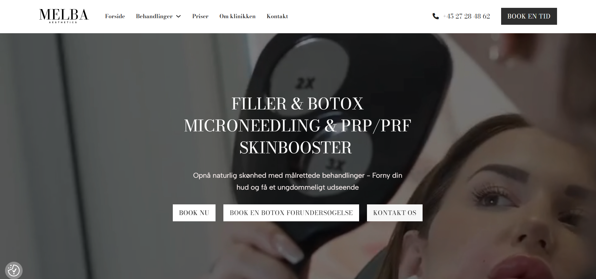
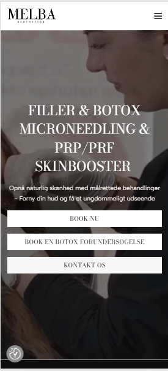
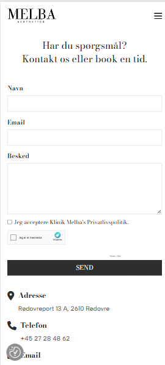
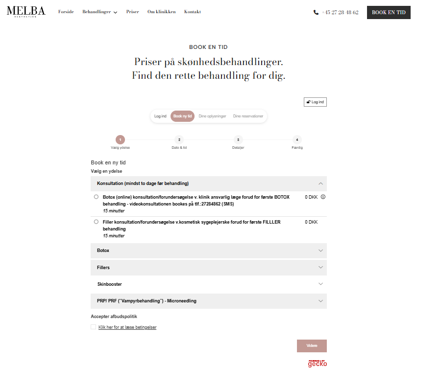
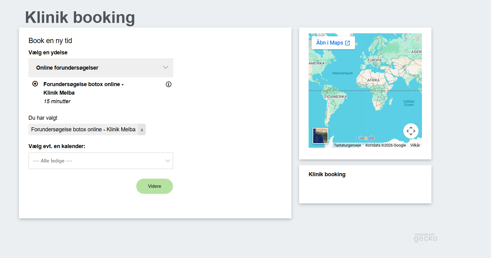
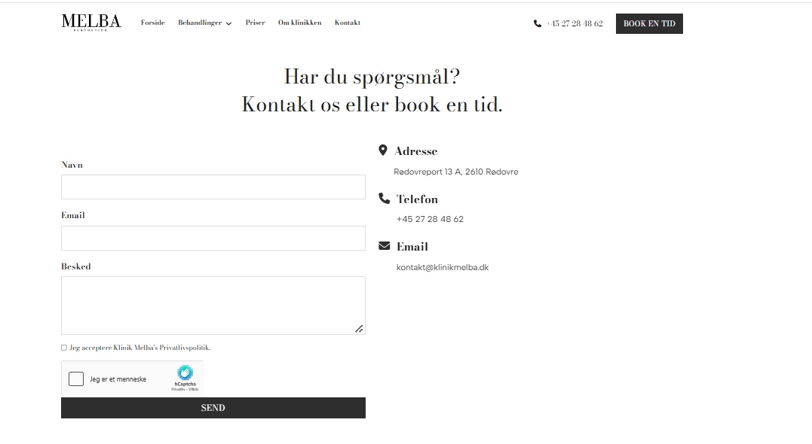
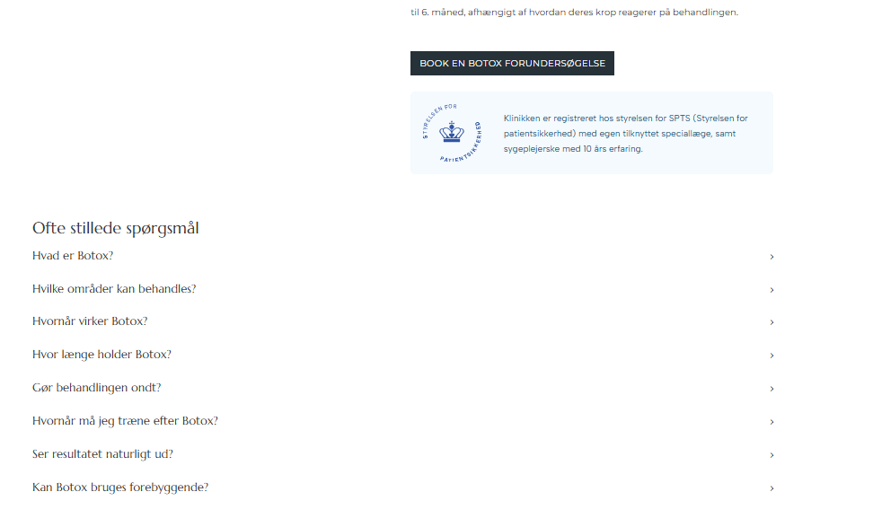

# Klinik Melba | Website Development

**Frontend Development | Web Design | Database Management | System Integration**

## Project Overview

Klinik Melba is a professional business website that I independently designed, developed and deployed for an aesthetics clinic in Denmark.

The project was developed in close collaboration with Melba, the clinic's owner. Through discussions about her vision, business requirements and design preferences, I translated her ideas into a complete website tailored to the clinic's identity and customer needs.

I was responsible for the entire development process, including planning, frontend development, database related work, responsive design, testing and deployment.

The website has been operating successfully for over a year and continues to support the clinic's daily operations. Melba has expressed great satisfaction with the finished product and its performance.

**Website:** https://klinikmelba.dk/

## Technologies Used

| Technology | Application |
|---|---|
| HTML5 | Website structure, semantic markup and content organisation |
| CSS3 | Responsive layouts, visual styling and interface design |
| JavaScript | Interactive components, dropdown menus and dynamic functionality |
| SQL / MySQL | Database operations and data management |
| Git / GitHub | Version control and development workflow |
| GECKO | Integration with an external appointment booking platform |

## Technical Implementation

### Interactive Treatment Pages and FAQ

I developed dedicated pages for the clinic's treatments, including Botox, fillers and skinbooster.

Each treatment page provides structured information to help customers understand the available services, treatment procedures and relevant aftercare.

I also implemented interactive FAQ sections where visitors can expand frequently asked questions to view detailed answers.

This functionality allows users to access relevant information without leaving the treatment page, improving usability while keeping the interface organised.

### Responsive Frontend Development

I developed responsive layouts to ensure that the website adapts to desktop, tablet and mobile devices.

The mobile version includes an adapted navigation menu, vertically arranged content sections and responsive booking and contact buttons.

The interface was designed to maintain readability, consistent styling and straightforward navigation across different screen sizes.

### GECKO Booking Integration

I connected the website to GECKO, an external appointment booking platform used by the clinic.

The booking integration enables customers to browse available treatments, select services, review booking conditions and continue through the appointment booking process.

This provides a connection between the website and the clinic's appointment management system without requiring a separate booking application.

### Contact Form and Customer Communication

I implemented a contact page with structured form fields for customer enquiries.

The form includes fields for name, email address and message, alongside privacy policy acknowledgement and spam protection.

The page also provides the clinic's contact details, making it easy for customers to get in touch.

### Navigation and User Experience

I developed a navigation structure that provides access to treatment information, pricing, clinic details, contact information and booking.

Interactive dropdown menus organise the available treatments, while clearly positioned booking buttons guide visitors towards the appointment process.

The website was designed with an emphasis on usability, visual consistency and intuitive customer navigation.

## Development Process

The development process began with identifying the clinic's requirements through direct communication with Melba.

I planned the website structure and visual design based on her preferences, then independently implemented the website and its functionality.

Throughout development, I incorporated her feedback to ensure that the final product reflected the clinic's identity and practical needs.

The completed website was tested and deployed under the clinic's domain.

## Project Outcome

The project resulted in a fully functional website that has been in operation for over a year.

It demonstrates my ability to independently deliver a digital solution for a real business, combining technical development, responsive design, third party integration and client communication.

The website continues to serve the clinic's customers, and the client remains satisfied with its design and functionality.

## Website Screenshots

### Homepage

### Responsive Mobile Design

**Mobile Homepage**

**Mobile Contact Page**

### GECKO Booking Integration

### Appointment Booking

### Contact Form

### Interactive Treatment FAQ

